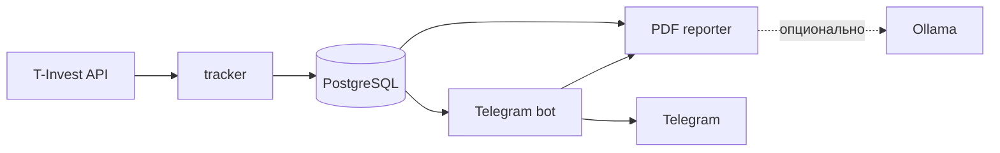

# FinanceTracker

Self-hosted сервис для учёта и анализа инвестиционного портфеля T‑Invest. Он регулярно сохраняет состояние портфеля, рассчитывает доходность и денежные потоки, а затем отправляет отчёты и уведомления в Telegram.

[](https://github.com/andrew-belikov/FinanceTracker/actions/workflows/ci.yml)
[](https://www.python.org/)
[](https://docs.docker.com/compose/)
[](https://www.postgresql.org/)

> Проект предназначен для личной аналитики и не совершает торговых операций. Его отчёты не являются инвестиционной рекомендацией.

## Возможности

- **История портфеля** — канонические end-of-day снапшоты стоимости и состава портфеля в PostgreSQL.
- **Отчёты в Telegram** — сводки за день, неделю, месяц и год, история стоимости и структура активов.
- **Доходность** — TWR, XIRR, реализованный и нереализованный результат с корректным учётом внешних денежных потоков.
- **Денежные события** — купоны, дивиденды, комиссии, налоги, пополнения, выводы и налоговый вычет ИИС.
- **Планирование** — целевая аллокация, расчёт ребалансировки и распределение нового пополнения.
- **Календарь выплат** — ожидаемые купоны и объявленные дивиденды на ближайшие 90 дней.
- **Расширенные отчёты** — месячный PDF и ZIP-датасет для самостоятельного анализа.
- **Автоматические уведомления** — новые выплаты, пополнения, максимум портфеля, выполнение годового плана и будничный внутридневной итог с графиком.

Основные команды бота: `/today`, `/week`, `/month`, `/monthpdf`, `/year`, `/history`, `/structure`, `/twr`, `/calendar`, `/targets`, `/rebalance`, `/invest` и `/dataset`.

В личном чате `/today_widget` отправляет новый виджет «Сегодня» со стоимостью портфеля, дневным изменением и интерактивным мини-графиком. После отправки бот удаляет предыдущий виджет, если Telegram разрешает удаление. Бот проверяет данные раз в минуту и обновляет последний отправленный виджет при изменениях.

`/today` и будничный итог используют общий расчёт изменения стоимости без собственных пополнений и выводов. Поле подписано «Изменение:». Покупки и продажи учитываются при расчёте переоценки бумаг, комиссии и НКД сделки отделяются от цены. В обоих отчётах есть точный период и сверка: цены бумаг, НКД, зачисленные выплаты, расходы и необъяснённый остаток. Ожидаемый купон показывается отдельно и не увеличивает фактический баланс. Подробные правила — в [контракте дневного отчёта](docs/contracts/daily-report.md).

## Архитектура



Система запускается одним Docker Compose-стеком:

- `tracker` получает данные T‑Invest и сохраняет снапшоты и операции;
- `bot` формирует отчёты, отвечает на команды и запускает рассылки;
- `reporter` собирает PDF, используя детерминированный fallback при недоступности Ollama;
- `migrate` применяет forward-миграции перед стартом прикладных сервисов;
- `xray-client` при необходимости предоставляет outbound proxy только для Telegram-бота;
- `db` хранит данные в отдельном Docker volume и не публикует порт на host.

Подробнее: [архитектура](docs/ARCHITECTURE.md), [карта проекта](docs/PROJECT_MAP.md)
и [каталог контрактов](docs/contracts/README.md).

## Быстрый старт

### Требования

- Docker Engine или Docker Desktop с Compose v2;
- токен Telegram-бота от [@BotFather](https://t.me/BotFather);
- токен T‑Invest API;
- Telegram user ID, которому разрешён доступ к боту.

### Запуск

1. Клонируйте репозиторий и перейдите в его каталог:

```bash
git clone https://github.com/andrew-belikov/FinanceTracker.git
cd FinanceTracker
```

2. Создайте локальную конфигурацию:

```bash
cp .env.example .env
${EDITOR:-vi} .env
```

Обязательно задайте:

```env
POSTGRES_PASSWORD=change-me
TELEGRAM_BOT_TOKEN=change-me
TINVEST_API_TOKEN=change-me
ALLOWED_USER_IDS=123456789
REPORTER_SERVICE_KEY=change-me-to-a-long-random-value
```

Для `REPORTER_SERVICE_KEY` используйте случайное значение длиной не менее 32 байт, например результат `openssl rand -hex 32`.

3. Создайте внешние Docker-ресурсы:

```bash
docker volume create financetracker_fintracker-db
```

Внешняя сеть не нужна базовому stack. Создайте её только для включённой Ollama:

```bash
docker network create localllm_localllm
```

4. Соберите и запустите сервисы:

```bash
docker compose up -d --build --wait
```

При `OLLAMA_ENABLED=true` используйте override:

```bash
docker compose -f compose.yml -f compose.ollama.yml up -d --build --wait
```

5. Проверьте состояние и логи:

```bash
docker compose ps
docker compose logs --tail=100 tracker bot reporter
```

Логгер маскирует Telegram-токены, значения `password` и `token` в тексте и
идентификаторы доступа в VLESS-ссылках. См. [стандарт логирования](docs/LOGGING_STANDARD.md).

При запуске сервис `migrate` автоматически применит ещё не выполненные forward-миграции. Не используйте `docker compose down -v`, если хотите сохранить базу данных.

На homeserver обновление прикладных контейнеров выполняет GitHub Actions после успешного CI на `main`. Серверные настройки сборки входят в проверяемый коммит.

Полная инструкция по обновлению, резервному копированию, миграциям и диагностике находится в [операционном руководстве](docs/RUNBOOK.md).

## Конфигурация

Все параметры перечислены в [.env.example](.env.example) и подробно описаны в [docs/CONFIG.md](docs/CONFIG.md). Основные группы настроек:

- доступ к PostgreSQL, Telegram и T‑Invest API;
- расписание отчётов и уведомлений;
- минутные внутридневные наблюдения и будничный итог в `19:10 Europe/Moscow`;
- правила выбора инвестиционного счёта;
- PDF reporter и опциональная Ollama;
- VLESS proxy для Telegram-трафика;
- тайм-ауты, лимиты и structured logging.

В будничном внутридневном итоге бумаги подписаны как `Название (Тикер)`;
каждая бумага в блоках роста и снижения занимает отдельную строку. График
обрезает ночную паузу даже после изменения около полуночи, показывает время по
`TIMEZONE` и отмечает начало основных торгов в `10:00 Europe/Moscow`.
Минимум, максимум и последнее значение подписаны суммами в тысячах рублей
с одним знаком после запятой; тот же формат используется на оси стоимости.
Минутные данные доставленного дня сохраняются до первого успешного сбора
следующего дня. Команда повторной проверки и отправки описана в
[операционном руководстве](docs/RUNBOOK.md#повторная-проверка-внутридневной-рассылки).

Доступ к боту ограничивается allowlist из `ALLOWED_USER_IDS`. Файл `.env` содержит секреты и не должен попадать в Git.

## Документация

Полный индекс действующих документов находится в
[docs/README.md](docs/README.md). Для эксплуатации начните с
[CONFIG.md](docs/CONFIG.md) и [RUNBOOK.md](docs/RUNBOOK.md); пользовательское
поведение и финансовые формулы описаны в [BEHAVIOR.md](docs/BEHAVIOR.md).

## Разработка

Проект использует Python 3.12, hash-locked зависимости и `unittest`. Команды
локальной проверки, правила изменения зависимостей и формат PR описаны в
[CONTRIBUTING.md](CONTRIBUTING.md); CI запускает обязательные проверки для
каждого `push` и `pull_request`.

## Лицензия и версии

Проект распространяется по [лицензии MIT](LICENSE).

Текущая официальная версия — `1.0.0`; релизы следуют SemVer и отмечаются
annotated Git tag. История выпусков ведётся в [CHANGELOG.md](CHANGELOG.md),
правила выпуска — в [CONTRIBUTING.md](CONTRIBUTING.md).
